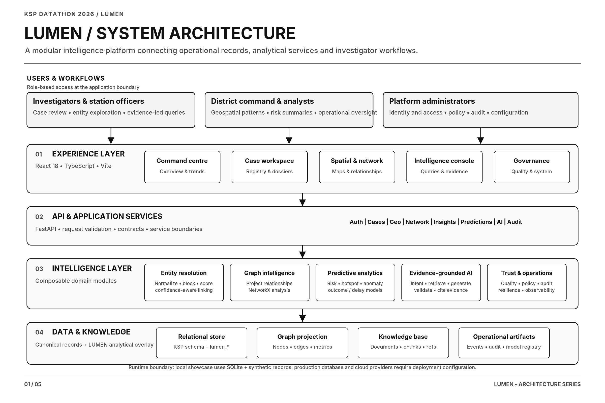
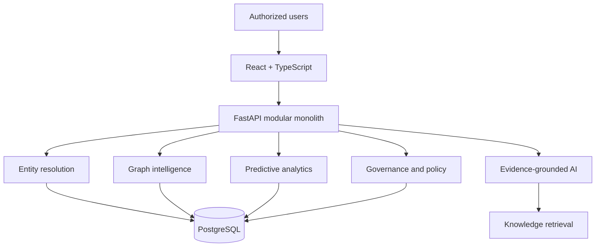

# LUMEN — Linked Urban Mapping Entities Network

**AI-assisted Crime Intelligence Platform | Karnataka State Police Datathon 2026**

LUMEN explores how fragmented crime records can be transformed into connected intelligence through entity resolution, graph analytics, geospatial analysis, predictive models, and evidence-grounded AI assistance.

The platform is designed as a decision-support system for authorized investigators and analysts. It surfaces relationships, patterns, evidence, and analytical context; it does not establish guilt or automate enforcement decisions.



[View the system architecture in SVG](docs/assets/architecture/svg/01-lumen-system-architecture.svg)

## Core capabilities

- **Entity resolution:** Identify candidate cross-case identity relationships using normalization, blocking, weighted matching, and confidence thresholds.
- **Graph intelligence:** Model relationships among people, cases, stations, officers, and other entities.
- **Geospatial intelligence:** Explore geographic distributions, hotspots, and spatial patterns.
- **Predictive analytics:** Analyze district-level risk, case-volume anomalies, reporting delays, and other intelligence signals.
- **Evidence-grounded AI:** Retrieve relevant records, generate contextual answers, and validate cited identifiers against retrieved evidence.
- **Governance and auditability:** Apply role-based access, data classification, provenance, confidence, and human-review boundaries.

## Architecture

The core platform follows a modular-monolith architecture.

| Layer | Technology |
|---|---|
| Frontend | React 18, TypeScript, Vite |
| Backend | Python, FastAPI |
| Persistence | SQLAlchemy, Alembic, PostgreSQL |
| Graph processing | NetworkX |
| Predictive analytics | Scikit-learn |
| Geospatial interface | Leaflet, React Leaflet |
| Deployment target | Zoho Catalyst services |

The Catalyst integrations represent the deployment architecture and target services; they should not be interpreted as proof that every external service is provisioned or live.



## Complete architecture documentation

The full engineering guide documents the project structure, data model, processing flows, entity-resolution logic, graph design, predictive modules, AI orchestration, governance, event processing, infrastructure, source-code map, architecture decisions, and implementation boundaries.

**[Read the complete LUMEN Project & System Architecture](docs/LUMEN_PROJECT_ARCHITECTURE.md)**

The guide includes five architecture diagrams in PNG and SVG formats, alongside editable Mermaid diagrams.

## Run the local showcase

The public `main` branch includes a standalone local showcase:

```bash
cd showcase-release
chmod +x *.sh
./start.sh
```

The showcase uses synthetic data and SQLite. It is a demonstration, not a live Karnataka State Police deployment. It does not connect to production police records or live QuickML inference.

## Repository branches

- **[main](https://github.com/Ashwath-Raj/LUMEN/tree/main):** Public local showcase and project documentation.
- **[lumen-development](https://github.com/Ashwath-Raj/LUMEN/tree/lumen-development):** Original core platform source, including `api/`, `client/`, `functions/`, `data/`, and core development documentation.

The core development source and the public showcase are maintained on separate branches. The architecture guide explains this distinction and identifies implemented components, deployment targets, and outstanding integration work.

## Project links

- [GitHub repository](https://github.com/Ashwath-Raj/LUMEN)
- [Core development branch](https://github.com/Ashwath-Raj/LUMEN/tree/lumen-development)
- [Local showcase](showcase-release/)
- [Full architecture guide](docs/LUMEN_PROJECT_ARCHITECTURE.md)
