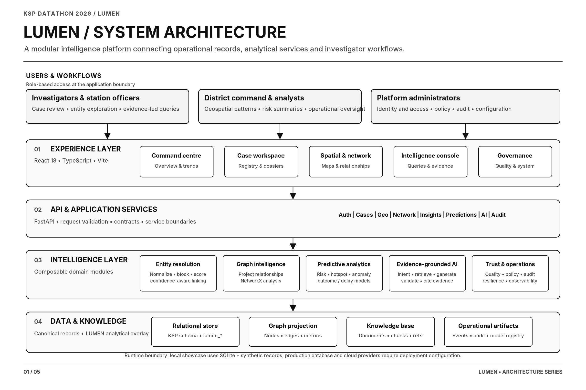
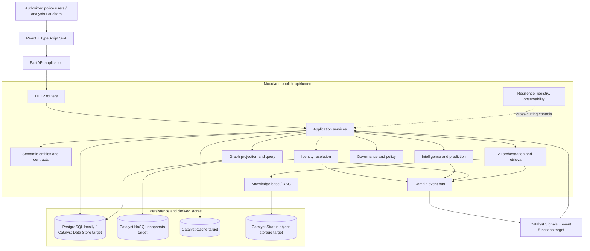
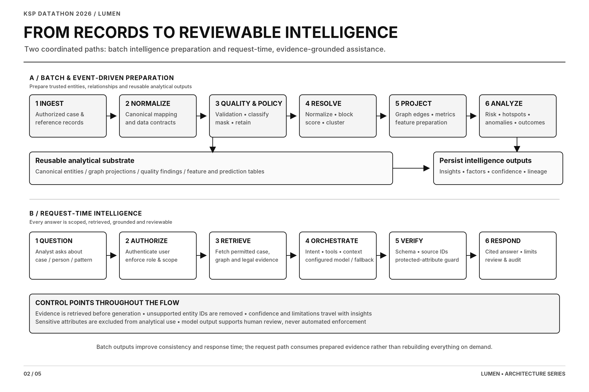
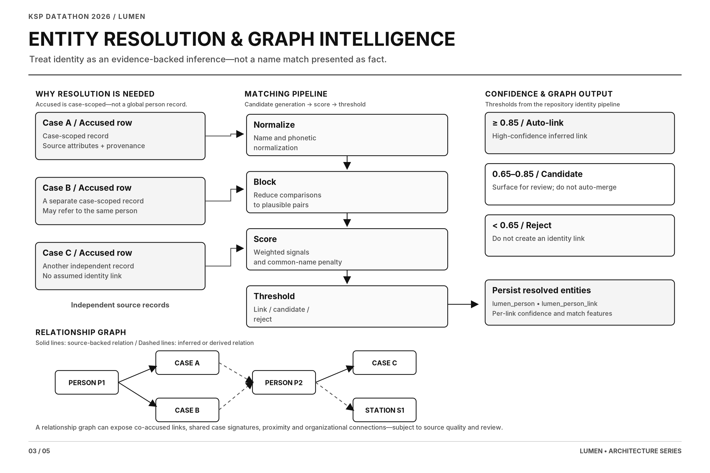
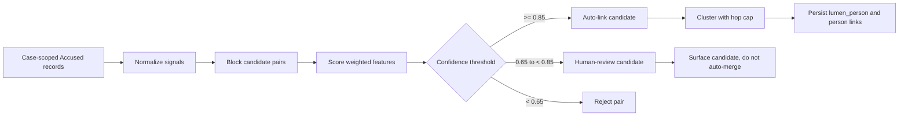
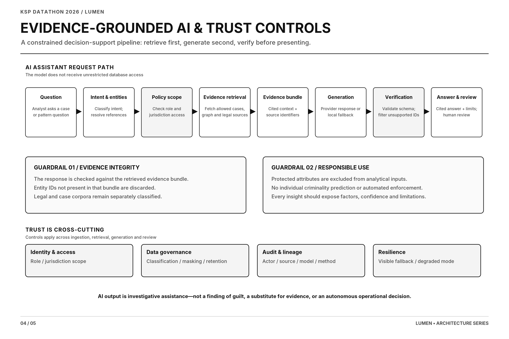
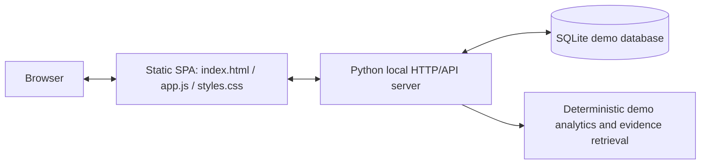
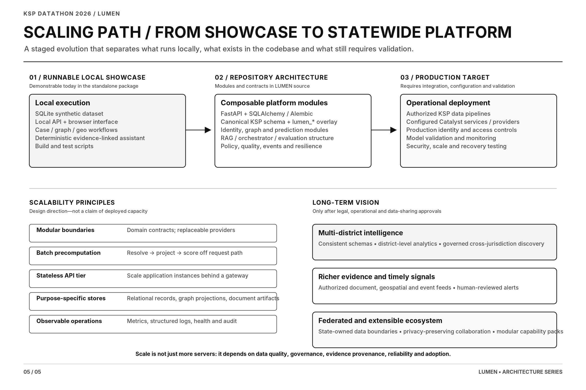

# LUMEN — Project & System Architecture

**Linked Urban Mapping Entities Network**
**AI-assisted Crime Intelligence Platform | Karnataka State Police Datathon 2026**
**Project repository:** [Ashwath-Raj/LUMEN](https://github.com/Ashwath-Raj/LUMEN)
**Documentation revision:** 1.0 · **Reviewed against repository state:** 5 November 2026

> This document is an engineering guide to the LUMEN project: its problem framing, architectural model, source-code organization, processing flows, design decisions, deployment target, local showcase, and implementation boundaries. It distinguishes the core platform source from the standalone local showcase and distinguishes implemented code from external integrations or future-state capabilities.

---

## 1. Project overview

LUMEN is an AI-assisted crime-intelligence platform conceived for Karnataka State Police workflows. Its objective is to move beyond isolated crime-record management and provide an analytical layer that can connect case records, infer cross-case entity relationships, identify spatial and temporal patterns, and present evidence-backed intelligence to authorized users.

The project combines:

- **Case and entity analysis** over a canonical police-record data model.
- **Entity resolution** to infer whether per-case identity records may refer to the same person.
- **Graph intelligence** to represent relationships among people, cases, officers, stations, jurisdictions, and other semantic entities.
- **Geospatial analysis** to explore crime distribution, geographic proximity, and hotspot patterns.
- **Predictive and anomaly analysis** for district risk, case-volume deviations, reporting delays, hotspots, and case outcomes.
- **Evidence-grounded AI assistance** to retrieve relevant records, assemble context, generate an answer through a provider interface, and verify cited identifiers against retrieved evidence.
- **Governance and explainability** so that outputs carry confidence, provenance, limitations, classification, and human-review boundaries.

LUMEN is designed as a decision-support platform. It does not establish guilt, make enforcement decisions, or replace an investigating officer's judgment.

### 1.1 The problem being addressed

Conventional record systems are optimized to register and retrieve individual records. Intelligence work often requires a different set of operations:

1. Find related records even when the source system does not provide a universal identity key.
2. Understand how cases and entities connect across time and geography.
3. Identify unusual changes or concentrations in recorded activity.
4. Move from a chart or score to the supporting records and explain why a result appeared.
5. Preserve access boundaries and avoid presenting uncertain inferences as facts.

LUMEN's architecture treats those operations as connected capabilities rather than independent dashboard widgets.

### 1.2 Product principles

The platform specification establishes the following architectural principles:

| Principle | Engineering interpretation |
|---|---|
| Intelligence over CRUD | Screens should generate, explain, review, or consume intelligence objects, not only expose database rows. |
| Evidence before AI | Models receive retrieved evidence bundles; they do not receive unrestricted database access. |
| Human in the loop | The system recommends and explains; an authorized human makes operational decisions. |
| Explainability by default | Scores and recommendations should carry factors, confidence, lineage, and limitations. |
| Event-driven intelligence | Relevant domain changes can emit events that trigger downstream work. |
| Catalyst-native deployment target | Use managed Catalyst services where the architecture maps a Catalyst equivalent; list exceptions explicitly. |
| Zero-trust access model | Requests should be authenticated, authorized, scoped, attributable, and auditable. |
| Extensibility | Capabilities should use contracts and registries rather than modifying unrelated core modules. |
| Protected-attribute exclusion | Protected attributes are not analytical features, filters, charts, or prompt inputs. |
| Identity uncertainty | Cross-case identity is inferred and must retain match confidence. |
| Data governance | Data assets have classification, ownership, retention, and masking requirements. |
| Visible degradation | Missing dependencies or stale data must be disclosed; missing values must not be fabricated. |

---

## 2. Repository and branch layout

The repository currently separates the original platform source and the standalone showcase by branch. This distinction matters when navigating GitHub.

| Branch | Purpose | What it contains |
|---|---|---|
| [`main`](https://github.com/Ashwath-Raj/LUMEN/tree/main) | Public showcase/release branch | Root README, `showcase-release/`, and this project architecture document. |
| [`lumen-development`](https://github.com/Ashwath-Raj/LUMEN/tree/lumen-development) | Core platform development source | Original `api/`, `client/`, `functions/`, `data/`, `docs/`, migration and infrastructure files. |
| [`feature/lumen-local-showcase`](https://github.com/Ashwath-Raj/LUMEN/tree/feature/lumen-local-showcase) | Showcase implementation history | Feature branch used to introduce the standalone showcase before it was added to `main`. |

**Important:** the full core platform source tree is currently on `lumen-development`. The `main` branch contains the standalone local showcase and public-facing documentation. Do not infer that every core file described below is present in `main` until the development source is intentionally merged or migrated there.

### 2.1 High-level source tree on `lumen-development`

```text
LUMEN/
├── api/                    FastAPI backend and Python domain modules
├── client/                 React + TypeScript single-page application
├── functions/              Catalyst event-function entry points
├── data/                   Canonical schema, evaluation set, seed notes
├── docs/                   Master specification, architecture, ADRs, runbook
├── .env.example            Environment-variable template
├── .catalystrc             Catalyst project configuration
├── catalyst.json           Catalyst deployment configuration
├── docker-compose.yml      Local multi-container development topology
├── Makefile                Common development and database tasks
└── README.md               Development-branch setup and orientation
```

### 2.2 Public showcase tree on `main`

```text
LUMEN/
├── README.md
├── docs/
│   └── LUMEN_PROJECT_ARCHITECTURE.md
└── showcase-release/
    ├── README.md
    ├── CHANGELOG.md
    ├── CONTRIBUTING.md
    ├── FEATURE-MATRIX.md
    ├── SHOWCASE-WALKTHROUGH.md
    ├── build.sh
    ├── clone-and-start.sh
    ├── start.sh
    ├── test.sh
    ├── docs/
    │   ├── ARCHITECTURE.md
    │   └── COMPLETION-STATUS.md
    └── showcase/
        ├── server.py
        ├── start.sh
        ├── data/README.md
        ├── tests/test_server.py
        └── web/
            ├── index.html
            ├── app.js
            ├── styles.css
            └── lumen.svg
```

---

## 3. System architecture


[View vector SVG](assets/architecture/svg/01-lumen-system-architecture.svg)


LUMEN's core target architecture is a **modular monolith**: one FastAPI application with strict internal module boundaries, plus a React SPA and event-triggered Catalyst Functions. The graph and ML modules can share process memory while keeping contracts between domains explicit.



### 3.1 User experience layer

The client is a React 18 and TypeScript SPA built with Vite. It is organized around investigation workflows rather than around a collection of unrelated dashboards. Pages are route-level lazy-loaded, and the shell supplies shared navigation, role gates, error boundaries, notification surfaces, and inspector patterns.

Primary user-facing surfaces defined in the client router include:

| Route | Purpose |
|---|---|
| `/` | Public mission/landing page |
| `/login` | Authentication entry point |
| `/briefing` | Intelligence briefing |
| `/command` | Command centre overview |
| `/geo` | Geospatial intelligence |
| `/cases` | Case registry and search |
| `/case/:id` | Case workspace and timeline/evidence/insights |
| `/person/:id` | Person dossier and inferred identity context |
| `/network` | Relationship/network exploration |
| `/ask` | Natural-language intelligence console |
| `/forecasts` | Predictive analytics and forecast surface |
| `/anomalies` | Anomaly register |
| `/quality` | Data-quality findings and scores |
| `/system` | Health, metrics, registry, and evaluation status |
| `/admin` | Restricted administration/audit surface |

The intended navigation model is drill-in oriented: users move from a case to a person, network, district, evidence item, or insight without losing the investigative context.

### 3.2 API and application layer

The FastAPI application exposes routers that parse requests, call a service/orchestrator, and return versioned contracts. Business logic belongs in domain/application modules; SQL access belongs in repository modules. This reduces coupling between transport, business rules, and storage details.

The original core API includes routers for:

- authentication and health;
- overview and cases;
- persons and network;
- geospatial queries;
- insights and predictions;
- quality;
- AI assistance;
- audit, briefing, and system operations.

The API is designed as a modular monolith rather than a microservice mesh. Catalyst Functions remain useful for asynchronous reactions to events, but the primary application logic is not split into dozens of separately deployed services.

### 3.3 Domain and contract layer

`api/lumen/contracts/` defines payload shapes that cross module boundaries. Contracts include entities, events, evidence, graph payloads, insights, and prediction results. The semantic layer provides a stable vocabulary so UI and AI modules do not need to know raw KSP table and column names.

The closed semantic vocabulary in the platform specification includes:

`Case`, `Person`, `CaseParticipant`, `Officer`, `Station`, `Jurisdiction`, `Court`, `Charge`, `CrimeType`, `ProcessEvent`, and `Insight`.

Repositories translate between this vocabulary and the canonical database schema.

---

## 4. Data architecture


[View vector SVG](assets/architecture/svg/02-records-to-intelligence-dataflow.svg)


### 4.1 Canonical KSP data model

The original platform adopts the supplied Police FIR System entity-relationship model as its canonical source schema. The intent is to preserve the source system's data model and add analytical structures alongside it rather than silently redefining police-record semantics.

The documented canonical domains are:

| Domain | Representative entities/tables |
|---|---|
| Geography | `State`, `District`, `Court` |
| Organization | `UnitType`, `Unit`, `Rank`, `Designation`, `Employee` |
| Legal taxonomy | `Act`, `Section`, `ActSectionAssociation`, `CrimeHead`, `CrimeSubHead`, `CrimeHeadActSection` |
| Case core | `CaseMaster`, `Victim`, `Accused`, `ComplainantDetails`, `ArrestSurrender`, `ChargesheetDetails`, `inv_arrestsurrenderaccused` |
| Lookups | `CaseCategory`, `GravityOffence`, `CaseStatusMaster` |
| Protected/demographic source fields | Caste, religion, occupation lookup tables and related source columns |

`CaseMaster` is the central case record. The supplied schema has no universal person master. `Accused` is a case-scoped row, and `Accused.PersonID` is an in-case sequence label such as `A1`, `A2`, not a cross-case identity key.

### 4.2 The LUMEN analytical overlay

LUMEN adds `lumen_`-prefixed structures keyed to canonical identifiers. These represent derived or platform-specific information without changing the meaning of the original police tables.

The overlay includes structures for:

- resolved people and person links;
- graph edges, graph metrics, and communities;
- quality findings and quality scores;
- predictions, district risk and hotspot outputs;
- insights and their lifecycle;
- domain events and audit records;
- knowledge-base documents and chunks;
- model, prompt, feature, and service registries;
- policy and evaluation metadata.

The database model is split into modules under `api/lumen/db/models/`. Alembic migrations under `api/alembic/versions/` describe schema evolution. The runbook identifies migrations `0001` through `0011` as the canonical baseline and successive LUMEN overlay additions. Consult the migration files for exact table definitions and ordering; do not rely on a guessed table count.

### 4.3 Persistence abstraction

The architecture uses SQLAlchemy repositories and a storage boundary so PostgreSQL can be used for local development while Catalyst Data Store is the intended deployed relational store. `db/datastore.py`, `db/repositories/`, and `db/session.py` are central to that boundary.

The broader Catalyst design also maps data classes to other managed services:

- **Data Store:** canonical and `lumen_` relational records.
- **NoSQL:** graph adjacency snapshots and selected unstructured/derived payloads.
- **Cache:** hot overview, graph, forecast, and AI response payloads.
- **Stratus:** evidence assets, source documents, exported briefings, and model artifacts.

These are target integration mappings. Their presence in the service map does not by itself prove that a production Catalyst environment has been provisioned or connected.

### 4.4 Data quality

The `quality/` domain contains rules, evaluation logic, and scoring. The documented approach is to turn detectable schema/data defects into explicit quality findings rather than silently rewriting source information.

Examples in the schema notes include:

- inconsistent key types between legal association tables;
- missing declared primary keys in parts of the source ERD;
- boolean-like values stored as text;
- an employee reference naming mismatch;
- possible disagreement between major and minor crime-head references.

The exact handling is documented in `docs/SCHEMA_NOTES.md` and the quality rule implementation. The objective is to make source data quality visible to users of derived intelligence.

---

## 5. Entity resolution and graph intelligence


[View vector SVG](assets/architecture/svg/03-entity-resolution-graph-intelligence.svg)


### 5.1 Entity resolution problem

The source KSP model does not contain a universal person master. The same real-world individual may appear in multiple case-scoped accused records, but the source schema does not provide a single authoritative cross-case key. A simple join on name would produce false matches, especially for common names.

LUMEN therefore models identity as an inference with confidence, not as an unquestionable fact.

### 5.2 Resolution pipeline

The core resolution package is `api/lumen/identity/`:



The documented threshold bands are:

| Pair score | Treatment |
|---|---|
| `>= 0.85` | Auto-link within the resolution process |
| `0.65–<0.85` | Candidate surfaced for review; not automatically merged |
| `<0.65` | Reject the candidate pair |

The pipeline is decomposed across:

- `identity/normalize.py` — normalization and blocking keys;
- `identity/features.py` — candidate-pair signals;
- `identity/scoring.py` — weighted pair scoring;
- `identity/pipeline.py` — blocking, scoring, thresholding, clustering;
- `jobs/resolve.py` — batch orchestration and persistence.

The feature design includes name similarity, phonetic agreement, implied birth-year agreement, gender agreement, shared district/station signals, shared resolved co-accused context, and a common-name penalty. These are matching signals, not proof of identity.

### 5.3 Graph model

The graph domain lives in `api/lumen/graph/`. The primary documented runtime is **NetworkX in-process**, with projections persisted to relational/managed stores. The graph adapter seam is in `graph/backend.py`; the legacy Neo4j service is retained as reference material and is not the primary graph backend in the frozen v3 design.

Graph nodes are semantic entities rather than raw SQL tables. The documented vocabulary includes people, cases, officers, stations, jurisdictions, courts, charges, and crime types.

Relationship examples include:

- person accused in a case;
- case registered at a station;
- case associated with an officer;
- person co-accused with another person;
- case sharing a crime signature or geographic proximity.

Projection and metrics are computed in batch, then read by API requests. The design avoids rebuilding expensive graph structures on every request. The graph metrics module contains graph measurement logic; the projection module materializes the derived graph representation; queries expose supported graph traversals.

### 5.4 Why the graph is in-process

ADR-001 records the decision to use NetworkX in-process because the Catalyst service map does not identify a native graph database. An external graph database would create an additional deployment dependency. A swappable backend interface keeps callers insulated from the actual graph implementation.

---

## 6. Predictive analytics and intelligence objects

### 6.1 Prediction modules

The prediction and intelligence domain is implemented under `api/lumen/intelligence/`. The documented model families include:

| Model family | Analytical purpose |
|---|---|
| District risk | District-level risk band and score |
| Hotspot clustering | Spatial concentration of cases |
| Volume anomaly | Unusual deviation from historical volume |
| Case linkage | Rank potentially related cases |
| Case outcome | Estimate outcome classes based on the available labelled outcome field |
| Reporting-delay anomaly | Identify unusual delays between incident and police-station information dates |

The prediction engine orchestrates the model scorers and converts model results into `Insight` records. The repository contains separate files for risk, hotspots, anomaly, linkage, outcome, features, explainability, confidence, counterfactuals, lifecycle, and guards.

**Interpretation boundary:** these are analytical outputs over the available or seeded dataset. Their presence does not establish operational forecasting accuracy, generalization to unseen districts, or suitability for field deployment. Training windows, data completeness, model validation, and limitations must travel with the result.

### 6.2 Insight as the output contract

`Insight` is the common intelligence output object. It is designed to hold more than a headline or scalar score. The contract carries fields such as:

- insight identifier and kind;
- subject type and subject identifier;
- headline or summary;
- confidence and confidence breakdown;
- factors and, where appropriate, counterfactuals;
- evidence references;
- limitations;
- lineage, method, model version, and prompt version;
- lifecycle state.

This makes the explanation and evidence part of the data contract rather than optional UI decoration.

### 6.3 Confidence decomposition

The specification describes confidence as a product of multiple components:

`composite confidence = evidence quality × model confidence × data completeness × identity confidence × graph confidence`

A low value in one stage can reduce confidence in the overall conclusion. The user interface is designed to show the component limiting confidence, not merely display a single opaque percentage.

### 6.4 Lifecycle and human review

Insights have lifecycle states. The architecture distinguishes generation from verification/approval and operational use. A recommendation is not an instruction. An officer or analyst remains responsible for deciding whether to act on an insight.

---

## 7. AI, retrieval, and evidence verification


[View vector SVG](assets/architecture/svg/04-evidence-grounded-ai-trust.svg)


### 7.1 AI architecture

The AI layer is under `api/lumen/ai/`. It is organized around one orchestrator and one provider call site. The model is not intended to query the database directly. Instead, application modules retrieve and scope the evidence bundle before prompt construction.

### 7.2 Twelve-step request flow

```mermaid
flowchart TD
    Q[User question] --> P9Q[Protected-attribute / prohibited-intent guard]
    P9Q --> I[1. Intent classification]
    I --> E[2. Entity resolution]
    E --> S[3. Jurisdiction and scope filtering]
    S --> T[4. Tool selection]
    T --> R[5. Evidence retrieval]
    R --> C[6. Prompt/context assembly]
    C --> G[7. Provider generation]
    G --> V[8. Schema validation, one retry]
    V --> H[9. Verify cited IDs against retrieved bundle]
    H --> CF[10. Confidence calculation]
    CF --> P9O[11. Output guard]
    P9O --> AU[12. Event/audit path]
    AU --> O[Insight(kind = summary)]
    G -.unavailable or invalid response.-> FB[Deterministic evidence-based fallback]
    FB --> H
```

The code-level orchestration is in `api/lumen/ai/orchestrator.py`. Supporting components include:

- `intent.py` — classifies the question;
- `toolsel.py` — selects the required retrieval/query tools;
- `retriever.py` — builds a scoped evidence bundle;
- `envelope.py` — prompt assembly, response parsing, and cited-ID verification;
- `provider.py` — the only LLM call boundary;
- `prompts/` — versioned prompt templates;
- `eval/` — evaluation rubric, adversarial cases, and evaluation runner.

### 7.3 Evidence verification

Generated cited identifiers are checked against the identifiers in the retrieved bundle. Identifiers that were not retrieved are dropped server-side. If there is insufficient evidence, the response can abstain or return a deterministic summary assembled from retrieved material, with the fallback method recorded in lineage and a limitation attached.

### 7.4 Provider and Catalyst target

The frozen architecture specifies **Catalyst QuickML as the primary LLM/RAG provider**. The `provider.py` module exposes the provider interface. Its current code requires a deployment-injected transport callable; when no transport is configured, the provider is unavailable and the orchestrator uses its deterministic fallback. A non-Catalyst provider may exist as a development/test fallback behind the same interface, but it is not the intended deployed provider.

Therefore, a code interface for QuickML is not the same as a verified live QuickML deployment. The deployment transport, credentials, network configuration, and end-to-end behaviour must be configured and tested in the target Catalyst environment.

### 7.5 Evaluation

The AI evaluation package measures dimensions such as intent accuracy, retrieval coverage, groundedness, hallucinated-ID handling, and abstention. The golden evaluation data lives under `data/eval/`. The presence of an evaluation harness is not a substitute for publishing actual benchmark results from a representative dataset.

---

## 8. Governance, policy, privacy, and trust

### 8.1 Data classification

The governance model defines four sensitivity classes:

| Class | Meaning | Example handling |
|---|---|---|
| PUBLIC | Safe for public display | No masking under the documented rules |
| INTERNAL | Police-wide operational data | Authenticated-role access |
| CONFIDENTIAL | Case-identifying operational data | Role and jurisdiction scope |
| RESTRICTED | Person-identifying or protected information | Role, scope, masking, and individual access audit |

Derived data inherits the highest classification among its inputs. Small aggregate groups are suppressed under the documented threshold to reduce re-identification risk.

### 8.2 Access policy

`api/lumen/policy/` contains the role model, authorization engine, and audit repository. The design describes roles such as State Analyst, District SP, Investigating Officer, Station Officer, and Auditor, each with different permissions and jurisdiction scopes.

The architecture centralizes authorization in `policy/engine.py`. Policy denials are expected to emit an event and be auditable. The detailed role/scope policy is documented in `docs/GOVERNANCE.md` on `lumen-development`.

### 8.3 Protected attributes

The specification explicitly excludes caste, religion, blood group, and disability status from analytical inputs. They must not be used in feature engineering, model prompts, filters, charts, or maps. The deny-list and output checks are in `intelligence/guards.py`, with masking/display rules in `governance/masking.py` and tests in `api/tests/test_p9_guards.py`.

### 8.4 Trust requirements

The intended trust chain is:

1. Evidence exists and is linked.
2. Confidence is decomposed and visible.
3. Lineage identifies the method/model/prompt version.
4. Limitations are stated.
5. Governance guards are applied.
6. Human review precedes operational use.
7. The access/action path is auditable.

LUMEN is not designed to predict individual criminality, rank people by likelihood of offending, or autonomously initiate enforcement actions.

---

## 9. Events, background jobs, resilience, and observability

### 9.1 Event bus

`api/lumen/bus/` defines the event catalog, event contracts/repository, and the controlled event publisher. The architecture keeps publication behind `bus/signals.py` so modules do not independently invent event transport behaviour.

The Catalyst target uses Signals and event functions for reactions such as resolution triggers, graph projection updates, quality processing, cache invalidation, and notifications. Function entry points are under `functions/`.

### 9.2 Batch precompute

The precompute pipeline is implemented under `api/lumen/jobs/`. Its dependency order is documented as:

```text
entity resolution
    -> graph projection and graph metrics
    -> data quality
    -> predictions (hotspots, anomalies, district risk, outcomes)
    -> feature precomputation
```

The intended job is idempotent and checkpointed. Heavy computation is kept off interactive request paths; APIs read precomputed outputs where that is appropriate.

### 9.3 Resilience

`api/lumen/resilience/` contains timeout, circuit-breaker, and degradation logic. The runbook defines a degradation ladder:

| Level | Mode | Behaviour |
|---|---|---|
| L0 | Full | All required dependencies healthy |
| L1 | Cached | Serve cached payloads and indicate staleness |
| L2 | Precomputed | Use precomputed data rather than unsupported ad-hoc computation |
| L3 | Deterministic | If LLM generation is unavailable, return an evidence-based deterministic summary |
| L4 | Read-only | If the store is degraded, serve the last usable snapshot and reject writes clearly |

Missing values should be represented as unavailable, not silently converted to zero or interpolated values.

### 9.4 Observability

`api/lumen/observability/` provides health, metrics, logging, and middleware. The documented system surfaces include dependency health, degradation state, insight counts, policy denials, AI fallback rate/latency, quality trends, registry information, and evaluation scorecards. Metrics that are not instrumented must be reported as unavailable rather than invented.

---

## 10. Frontend source map

The frontend source lives in `client/app/src/` on `lumen-development`. The files are grouped by responsibility rather than by one monolithic page.

### 10.1 Application entry, routing, providers, and layouts

| Path | Responsibility |
|---|---|
| `client/app/src/main.tsx` | SPA entry point |
| `client/app/src/router.tsx` | Route definitions, lazy loading, authentication and role gates, page error boundaries |
| `client/app/src/providers/AppProviders.tsx` | Composes application-wide providers |
| `client/app/src/providers/QueryProvider.tsx` | TanStack Query configuration |
| `client/app/src/providers/SessionProvider.tsx` and `sessionContext.ts` | Session context and state |
| `client/app/src/layouts/AppShell.tsx` | Authenticated application shell |
| `client/app/src/layouts/PublicLayout.tsx` | Public/unauthenticated layout |
| `client/app/src/styles/global.css` | Global styles and design foundation |

### 10.2 API client and hooks

`client/app/src/api/` is the frontend transport boundary. `client.ts` handles the HTTP client, `endpoints.ts` centralizes paths, `authService.ts` handles the authentication adapter, and `graphAdapter.ts` translates graph payloads for the graph surface.

The `api/hooks/` files provide query/mutation hooks for cases, case activity, case insights, linked records, lookups, timelines, geospatial data, graph data, insights, intelligence, operations, overview, and persons. `queryKeys.ts` defines cache keys; `unavailable.ts` provides explicit handling for unavailable surfaces.

### 10.3 Feature pages

| Feature directory | Principal files | Responsibility |
|---|---|---|
| `features/landing/` | `LandingPage.tsx` | Public product landing page |
| `features/login/` | `LoginPage.tsx` | Sign-in surface |
| `features/briefing/` | `BriefingPage.tsx` | Shift/intelligence briefing |
| `features/command/` | `CommandPage.tsx` | Command-centre KPIs, trends, priority insights |
| `features/geo/` | `GeoPage.tsx`, `MapCanvas.tsx`, `GeoTableFallback.tsx`, controls, clustering and boundary helpers | Geospatial analysis and map fallbacks |
| `features/cases/` | `CaseRegistryPage.tsx`, `caseColumns.tsx`, `caseFilterFields.ts` | Case search, filters, registry |
| `features/case/` | `CaseWorkspacePage.tsx`, `CaseHeader.tsx`, `CaseSummaryStrip.tsx`, `AssignmentPanel.tsx`, `StatusPanel.tsx`, tabs | Case detail, activity, board, evidence, insights, overview, timeline |
| `features/person/` | `PersonDossierPage.tsx` | Inferred person profile and linked records |
| `features/network/` | `NetworkPage.tsx`, `QueryParamsForm.tsx`, `namedQueries.ts`, `queryParams.ts` | Network exploration and graph query parameters |
| `features/ask/` | `IntelligenceConsolePage.tsx`, `EvidenceExplorer.tsx`, `workbenchUrlState.ts` | AI-assisted querying and evidence inspection |
| `features/forecasts/` | `ForecastsPage.tsx` | Predictive outputs and forecast views |
| `features/anomalies/` | `AnomalyRegisterPage.tsx` | Anomaly review |
| `features/quality/` | `DataQualityPage.tsx` | Quality findings and scores |
| `features/system/` | `SystemPage.tsx` | Health, metrics, registry, evaluation |
| `features/admin/` | `AdminPage.tsx` | Restricted administrative/audit surface |
| `features/` | `NotFoundPage.tsx` | Unknown-route handling |

### 10.4 Shared components

| Component group | Files / responsibility |
|---|---|
| Authentication | `components/auth/RequireAuth.tsx`, `RequireRole.tsx` — route-level session and role gates |
| Case | `components/case/CrimeNoDecoder.tsx` — structured crime-number presentation |
| Confidence | `components/confidence/Bar.tsx`, `ConfidenceBreakdown.tsx`, `ConfidenceMeter.tsx`, `FactorBars.tsx` — visible confidence and factors |
| Entity | `components/entity/EntityCard.tsx`, `entityRef.ts` — semantic entity display and references |
| Evidence | `components/evidence/EvidenceChip.tsx`, `EvidenceRow.tsx`, `EvidenceSection.tsx` — cited evidence display |
| Filters | `components/filters/FilterBar.tsx`, `FilterFieldEditor.tsx`, `types.ts` — reusable filters |
| Graph | `components/graph/GraphCanvas.tsx`, `GraphSurface.tsx`, error boundary, table fallback, styles — graph rendering and fallback |
| Insight | `components/insight/InsightCard.tsx`, `InsightActions.tsx`, `LineagePanel.tsx`, `LimitationsNote.tsx`, `CounterfactualsNote.tsx`, `RecommendationSection.tsx` — complete insight presentation |
| Intelligence | Analyst query box, evidence panel, reasoning panel, confidence badge, related entity and recommendation cards |
| Person | `components/person/IdentityBanner.tsx` — inferred-match confidence and disclosure |
| Shell | Left rail, top bar, notification tray, global search, degradation pill, workstation notice |
| States | Query boundaries, degraded states, delayed skeletons, staleness banners |
| Trust | Classification, lifecycle, quality, risk, and trust badges/statements |
| Inspector | `components/inspector/InspectorPanel.tsx` — contextual entity inspection |
| Errors | `components/PanelErrorBoundary.tsx` — local error containment |

### 10.5 Design system and supporting code

- `design/primitives/` contains reusable badges, buttons, grids, panels, tabs, skeletons, stats, pagination, and empty/error states.
- `design/tokens/` contains shared design tokens and token CSS.
- `hooks/` contains delayed-state and inspector hooks.
- `types/` contains typed contracts for cases, filters, geo, graphs, insights, overview, persons, sessions, timelines, and envelopes.
- `utils/` contains case-filter state, class-name helpers, URL state, and shared utilities.

---

## 11. Backend source map

The backend package is `api/lumen/`. Its directory boundaries mirror the system's domain architecture.

| Package | Important files | Responsibility |
|---|---|---|
| `api/` | `main.py`, `deps.py`, exception handlers/exceptions, `routers/` | FastAPI app composition, dependencies, error translation and HTTP endpoints |
| `contracts/` | `entity.py`, `event.py`, `evidence.py`, `graph.py`, `insight.py`, `prediction.py` | Versioned cross-module payload contracts |
| `semantics/` | `entities.py`, `render.py` | Canonical semantic vocabulary and display forms |
| `db/models/` | `canonical.py`, `identity.py`, `graph.py`, `intelligence.py`, `prediction.py`, `quality.py`, `event.py`, `kb.py`, `policy.py`, `feature.py`, `prompt.py`, `eval.py`, `registry.py` | SQLAlchemy models for source schema and platform overlay |
| `db/repositories/` | `base.py`, `sqlalchemy_repository.py`, `domain_repositories.py`, `semantic_repositories.py` | Persistence abstraction and translation between semantic entities and storage |
| `db/` | `session.py`, `datastore.py` | Database sessions and Catalyst Data Store adapter boundary |
| `identity/` | `normalize.py`, `features.py`, `scoring.py`, `pipeline.py` | Cross-case identity inference |
| `graph/` | `backend.py`, `projection.py`, `queries.py`, `metrics.py`, `legacy_neo4j_service.py` | Graph adapter, batch projections, traversals and graph metrics |
| `quality/` | `rules.py`, `engine.py`, `scoring.py` | Data-quality rules, findings and scores |
| `intelligence/` | `engine.py`, `features.py`, `risk.py`, `hotspots.py`, `anomaly.py`, `linkage.py`, `outcome.py`, `confidence.py`, `counterfactual.py`, `explain.py`, `lifecycle.py`, `guards.py` | Prediction orchestration, interpretable outputs, confidence, lifecycle and analytical safeguards |
| `kb/` | `ingest.py`, `retrieve.py` | Knowledge-base ingestion and retrieval |
| `ai/` | `intent.py`, `toolsel.py`, `retriever.py`, `envelope.py`, `provider.py`, `orchestrator.py`, `prompts/`, `eval/` | Question interpretation, evidence retrieval, prompt assembly, provider call, validation, orchestration and evaluation |
| `bus/` | `catalog.py`, `events.py`, `repository.py`, `signals.py` | Domain event definitions, persistence and publication boundary |
| `governance/` | `classification.py`, `masking.py`, `retention.py` | Data classification, masking and retention policy helpers |
| `policy/` | `roles.py`, `engine.py`, `audit_repo.py` | Role definitions, centralized authorization and audit persistence |
| `registry/` | `models.py`, `prompts.py`, `services.py` | Model, prompt and service registry |
| `resilience/` | `breaker.py`, `degradation.py`, `timeouts.py` | Circuit breakers, failure handling, and degradation state |
| `observability/` | `health.py`, `logging.py`, `metrics.py`, `middleware.py` | Health surfaces, structured logging, metrics and middleware |
| `services/` | `cache.py`, `command_center.py`, `crime_number_service.py`, `executive_dashboard.py`, `geospatial_service.py`, `intelligence_profile.py`, `module_service.py`, `officer_workbench.py`, `workflow_service.py` | Application services and user-workflow facades |
| `jobs/` | `precompute.py`, `resolve.py`, `quality.py`, `seed.py`, `kb_ingest.py`, `feature_precompute.py`, `seeds/karnataka/` | Batch workflows, dataset setup, and idempotent recomputation |
| `accelerators/` | `briefing.py`, `notify.py`, `zia.py` | Adapters for briefing generation, notifications, OCR/voice service integration |

### 11.1 HTTP router files

`api/lumen/api/routers/` contains the HTTP surface:

- `auth.py` — authentication surface;
- `health.py` — health checks;
- `overview.py` — command-centre summary and trends;
- `cases.py` — case registry and case detail;
- `persons.py` — person dossier and identity endpoints;
- `network.py` — graph/network queries;
- `geo.py` — geospatial endpoints;
- `insights.py` — insight retrieval and lifecycle actions;
- `predictions.py` — prediction outputs;
- `quality.py` — quality findings/scores;
- `ai.py` — AI question/answer orchestration;
- `audit.py` — audit access;
- `briefing.py` — briefing generation;
- `system.py` — health, metrics, registry, and evaluation diagnostics.

### 11.2 API application entry point and current integration caveat

`api/main.py` composes the FastAPI app and includes the routers. The current source comments describe its lifespan as a no-op and explicitly state that database schema creation/seeding and some runtime integration were deferred to later build sessions. This means that the existence of a router or domain module should not be treated as proof that the entire service is currently deployable end-to-end without further bootstrap and integration work.

---

## 12. Background functions and infrastructure

### 12.1 Catalyst Functions

The development branch contains event-function packages:

| Function directory | Intended trigger/work |
|---|---|
| `functions/on_case_registered/` | React to new case registration |
| `functions/on_anomaly_detected/` | React to anomaly events |
| `functions/on_graph_projected/` | React when graph projections complete |
| `functions/on_quality_finding/` | React to data-quality findings |

Each function directory contains a `main.py`, a Catalyst config, requirements file, and short README. They are event-handler entry points; they do not replace the FastAPI domain modules.

### 12.2 Root and service configuration

| File | Responsibility |
|---|---|
| `.env.example` | Environment-variable template; contains placeholders, not deployable secrets |
| `.gitignore` | Excludes local secrets, caches, and generated files |
| `.dockerignore` | Docker build context exclusions |
| `.catalystrc` | Catalyst CLI/project context |
| `catalyst.json` | Catalyst project/deployment configuration |
| `docker-compose.yml` | Local container topology for PostgreSQL, initialization, backend and frontend |
| `Makefile` | Common database, backend, test, and evaluation commands |
| `api/Dockerfile` | Backend container build |
| `api/app-config.json` | AppSail app configuration/start command template |
| `api/alembic.ini`, `api/alembic/` | Alembic migration configuration/environment/history |
| `client/Dockerfile`, `client/nginx.conf` | Frontend container and static hosting configuration |
| `client/package.json` | Frontend dependencies and scripts |
| `client/vite.config.js`, `client/tsconfig.json` | Frontend build and TypeScript configuration |
| `client/playwright.config.ts` | Browser test configuration |

### 12.3 Data directory

- `data/schema.sql` — canonical schema DDL/reference.
- `data/eval/golden.yaml` — AI evaluation cases and expected behaviour.
- `data/seeds/README.md` — seed-data notes.

The original backend also contains Karnataka seed-generation modules under `api/lumen/jobs/seeds/karnataka/` for geography, ranks, units, classification, and FIR generation. Seeded/synthetic data is for reproducible development and demonstration; it is not equivalent to authorized operational police data.

---

## 13. Local showcase architecture (`main` branch)

The `showcase-release/` directory is a separate, self-contained demonstration runtime intended to be easy to clone and run locally. It is deliberately distinct from the core Catalyst-targeted application architecture.

### 13.1 Components

| File | Responsibility |
|---|---|
| `showcase/server.py` | Python HTTP/API server, local data access, demo endpoints and deterministic demo logic |
| `showcase/web/index.html` | Single-page application shell |
| `showcase/web/app.js` | Client-side navigation, API calls, rendering and interactions |
| `showcase/web/styles.css` | Visual styling and layout |
| `showcase/web/lumen.svg` | Local product mark |
| `showcase/tests/test_server.py` | API and static-serving tests |
| `showcase/start.sh` | Starts the local showcase runtime |
| `start.sh` | Convenience entry point from the package root |
| `build.sh` | Shell/Python/JavaScript syntax checks and test runner |
| `test.sh` | Test-suite entry point |
| `clone-and-start.sh` | Clones the repository and prepares/starts the local showcase |
| `README.md` | Setup and usage guide |
| `FEATURE-MATRIX.md` | Capability status and demo boundaries |
| `SHOWCASE-WALKTHROUGH.md` | Suggested walkthrough |
| `docs/ARCHITECTURE.md` | Local showcase architecture |
| `docs/COMPLETION-STATUS.md` | Implemented, simulated, and outstanding work |
| `CONTRIBUTING.md` | Contribution instructions |
| `CHANGELOG.md` | Showcase release notes |
| `.gitignore` | Local environment/cache/database exclusions |
| `showcase/data/README.md` | Synthetic dataset notes |

### 13.2 Local showcase execution flow



The local showcase includes a synthetic-data path for the principal screens and API flows. It is suitable for local review and demonstration, not for handling real police records.

### 13.3 Showcase boundaries

The local package explicitly differs from the target platform:

- It uses **synthetic demonstration data**.
- It uses **SQLite** for the local showcase database.
- Its AI-style responses are deterministic/evidence-backed demo logic, not a live QuickML or Gemini integration.
- It does not establish production-grade authentication or role enforcement.
- It does not connect to a live KSP/CCTNS source system.
- It does not constitute a deployed Zoho Catalyst environment.

The showcase test suite currently reports 10 passing API tests when run through `showcase-release/build.sh` in the recorded local validation. Re-run the build command in the current environment before treating that result as a fresh CI result.

---

## 14. Architecture decision records

The core architecture records ten decisions under `docs/ADR/` on `lumen-development`:

| ADR | Decision | Why it matters |
|---|---|---|
| ADR-001 | NetworkX in-process for graph analytics | Avoids an extra graph-service dependency; projections are persisted and backend is swappable. |
| ADR-002 | Adopt the supplied KSP ERD as canonical | Preserves source-data provenance and avoids inventing a competing source schema. |
| ADR-003 | Build explicit entity resolution | `Accused` is case-scoped; cross-case identity must be inferred with confidence. |
| ADR-004 | Explainability is represented structurally | Evidence, factors, confidence, lineage, and limitations belong in the `Insight` object. |
| ADR-005 | QuickML is the primary LLM provider | Aligns the target deployment with Catalyst's managed LLM/RAG capability. |
| ADR-006 | Modular monolith on AppSail | Keeps shared graph/ML runtime state while preserving internal module boundaries. |
| ADR-007 | Confidence is decomposed | Exposes evidence, model, completeness, identity, and graph uncertainty. |
| ADR-008 | Data quality is a product capability | Quality defects become reviewable findings rather than hidden preprocessing. |
| ADR-009 | Batch precompute for expensive work | Keeps graph and prediction computation off latency-sensitive request paths. |
| ADR-010 | Protected attributes are stored but not analyzed | Prevents protected attributes from becoming predictive or ranking features. |

The master specification declares the architecture frozen at v3. Changes should be recorded through the documented change-control process rather than introduced as undocumented architectural drift.

---

## 15. Implemented architecture versus target integrations

The following table is intentionally conservative. It separates repository code and design from external service activation.

| Area | Repository evidence | Boundary / qualification |
|---|---|---|
| React application | Routes, pages, components, API hooks, design system, and browser tests exist on `lumen-development` | Verify a full frontend-to-backend path against a running environment. |
| FastAPI backend | App entry point, routers, domain packages, models, repositories, and tests exist on `lumen-development` | `api/main.py` documents deferred startup/bootstrap work; complete runtime integration must be verified. |
| Canonical schema and migrations | SQLAlchemy models and Alembic migrations are present | Run migrations against the intended database and validate all repositories. |
| Entity resolution | Normalization, feature, score, threshold, cluster, and job modules exist | Validate precision/recall with authorized representative records and human review. |
| Graph analytics | NetworkX backend, projections, metrics, and query modules exist | Verify batch jobs, persistence adapters, latency, and data scale in target deployment. |
| Prediction modules | Model scorer files and prediction orchestration exist | Model performance and suitability require dataset-specific evaluation; do not claim validated operational accuracy without results. |
| AI orchestration | Intent, retrieval, tool selection, envelope, orchestrator, provider interface, and evaluation modules exist | QuickML transport and target credentials are not automatically configured by the interface. Deterministic fallback is available when generation is unavailable. |
| Catalyst services | Service map and adapter boundaries are documented | AppSail, Data Store, QuickML, Zia, Signals, Cache, NoSQL, Stratus, Cron, Mail, Push and Pipelines must be provisioned/configured and verified in the actual Catalyst account. |
| Local showcase | Standalone Python/SQLite app and 10 API tests | Synthetic demonstration only; no production auth, real KSP data, or live external AI. |

### 15.1 Explicitly documented roadmap items

The master specification classifies several ideas as designed/documented rather than built:

- Multi-agent supervisor and specialist-agent decomposition.
- District digital twin requiring additional patrol/resource feeds.
- Plugin SDK and intelligence capability marketplace.
- Research extensions such as graph neural networks, federated learning, multimodal evidence, and cross-state federation.

These are roadmap directions. They should not be described as current running capabilities.

---

## 16. Local development and showcase commands

### 16.1 Run the local showcase

From the repository root on `main`:

```bash
cd showcase-release
chmod +x *.sh
./start.sh
```

Open the local URL printed by the script. The package README is the source of truth for runtime prerequisites and the selected port.

### 16.2 Validate the local showcase

```bash
cd showcase-release
./build.sh
```

This checks shell scripts, Python/JavaScript syntax, and runs the showcase API tests.

### 16.3 Core development branch

To inspect the original platform source:

```bash
git clone --branch lumen-development --single-branch \
  https://github.com/Ashwath-Raj/LUMEN.git LUMEN-core
```

Follow the `lumen-development/README.md`, `docs/RUNBOOK.md`, and `Makefile` instructions for core application setup. Core development involves PostgreSQL, Alembic, FastAPI, Node.js tooling, and optional Catalyst configuration; it is not the same one-command local showcase path.

---

## 17. Recommended next engineering milestones


[View vector SVG](assets/architecture/svg/05-scaling-roadmap.svg)


A sensible path from repository prototype to a stronger integrated demonstration is:

1. **Branch and documentation alignment:** decide whether `lumen-development` should be merged into `main` or maintained as the core development branch; keep the README explicit about this.
2. **Backend bootstrap:** complete and verify startup configuration, database session creation, migration execution, and seed/precompute commands.
3. **Frontend-to-API integration:** run the client against the core API and verify each principal route with persisted data.
4. **Catalyst environment:** provision and test AppSail, Data Store, Authentication, QuickML, Signals, Cache, NoSQL, Stratus, Cron and any required accelerator services.
5. **Provider verification:** configure the QuickML transport and test successful generation, schema validation, cited-ID filtering, abstention, timeout, and deterministic fallback.
6. **Data validation:** use authorized, de-identified or approved representative data; validate schema assumptions and data-quality rules.
7. **Model evaluation:** publish per-model test methodology, time windows, geographic coverage, baselines, calibration, error analysis, and limitations.
8. **Security review:** validate role/scope enforcement, masking, audit coverage, secrets handling, retention, export controls, and deployment hardening.
9. **Performance and reliability:** benchmark graph-query latency, precompute duration, API throughput, caching, degradation paths, and recovery.
10. **Operational governance:** run a documented human-review workflow with feedback, dispute handling, audit inspection, and an explicit prohibition on autonomous enforcement.

---

## 18. Key source references

The links below point to the core source branch because the `main` branch currently publishes the standalone showcase and this documentation.

### Project and specifications

- [Core project README](https://github.com/Ashwath-Raj/LUMEN/blob/lumen-development/README.md)
- [Master platform specification v3](https://github.com/Ashwath-Raj/LUMEN/blob/lumen-development/docs/LUMEN_MASTER_SPEC_V3.md)
- [Architecture as built](https://github.com/Ashwath-Raj/LUMEN/blob/lumen-development/docs/ARCHITECTURE.md)
- [Frontend architecture](https://github.com/Ashwath-Raj/LUMEN/blob/lumen-development/docs/Lumen%20frontend%20architecture%20v2.md)
- [Migration record](https://github.com/Ashwath-Raj/LUMEN/blob/lumen-development/docs/MIGRATION.md)

### Data, governance, and operations

- [Schema notes](https://github.com/Ashwath-Raj/LUMEN/blob/lumen-development/docs/SCHEMA_NOTES.md)
- [Governance model](https://github.com/Ashwath-Raj/LUMEN/blob/lumen-development/docs/GOVERNANCE.md)
- [Catalyst service map](https://github.com/Ashwath-Raj/LUMEN/blob/lumen-development/docs/CATALYST_MAP.md)
- [Runbook](https://github.com/Ashwath-Raj/LUMEN/blob/lumen-development/docs/RUNBOOK.md)
- [Architecture decision records](https://github.com/Ashwath-Raj/LUMEN/tree/lumen-development/docs/ADR)

### Core code entry points

- [FastAPI application](https://github.com/Ashwath-Raj/LUMEN/blob/lumen-development/api/main.py)
- [AI orchestrator](https://github.com/Ashwath-Raj/LUMEN/blob/lumen-development/api/lumen/ai/orchestrator.py)
- [AI provider boundary](https://github.com/Ashwath-Raj/LUMEN/blob/lumen-development/api/lumen/ai/provider.py)
- [Entity-resolution pipeline](https://github.com/Ashwath-Raj/LUMEN/blob/lumen-development/api/lumen/identity/pipeline.py)
- [Graph backend](https://github.com/Ashwath-Raj/LUMEN/blob/lumen-development/api/lumen/graph/backend.py)
- [Prediction engine](https://github.com/Ashwath-Raj/LUMEN/blob/lumen-development/api/lumen/intelligence/engine.py)
- [Frontend router](https://github.com/Ashwath-Raj/LUMEN/blob/lumen-development/client/app/src/router.tsx)
- [Catalyst event functions](https://github.com/Ashwath-Raj/LUMEN/tree/lumen-development/functions)

### Public local showcase

- [Showcase README](../showcase-release/README.md)
- [Showcase feature matrix](../showcase-release/FEATURE-MATRIX.md)
- [Showcase completion status](../showcase-release/docs/COMPLETION-STATUS.md)
- [Showcase walkthrough](../showcase-release/SHOWCASE-WALKTHROUGH.md)

---

## 19. Terminology

| Term | Meaning in LUMEN |
|---|---|
| Canonical record | A source-domain row from the adopted police-record schema |
| Semantic entity | A normalized domain concept such as `Case`, `Person`, or `Officer` |
| Entity resolution | Inference that multiple case-scoped records may refer to one real-world entity |
| Candidate match | A possible identity link retained for human review rather than automatically merged |
| Graph projection | Batch transformation from canonical/derived records into graph nodes and edges |
| Insight | Versioned intelligence output carrying evidence, confidence, lineage, and limitations |
| Evidence bundle | Scoped set of retrieved records/chunks supplied to an AI operation |
| Deterministic fallback | Non-LLM answer assembled from retrieved evidence when generation is unavailable |
| Degradation level | Explicit indication of which dependency-backed capability is currently unavailable or stale |
| Showcase | Standalone local demonstration using synthetic data, separate from the Catalyst-targeted core platform |

---

**LUMEN's central architectural idea:** connect records without pretending that uncertain relationships are facts; generate intelligence without losing its evidence; and make the system's confidence, limitations, and human decision boundary visible at every stage.
