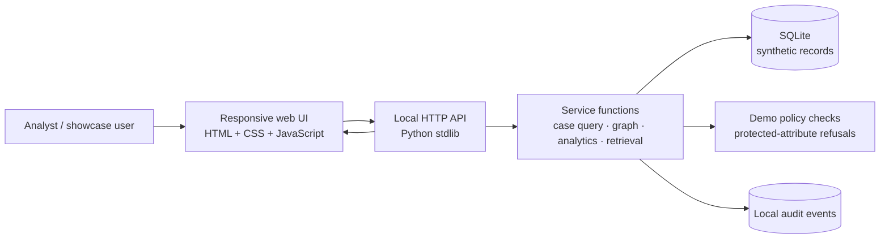

# LUMEN showcase architecture

## Data flow

1. The first launch creates a SQLite schema and deterministic synthetic records.
2. The command centre aggregates the case corpus and derives descriptive district indicators.
3. Network intelligence projects co-occurrence relationships from the case-person association table.
4. Entity dossiers display the associated records and per-link confidence fields.
5. The assistant retrieves matching synthetic records or aggregate summaries and returns evidence identifiers.
6. Selected interactions append local audit events.

## Runtime properties

- One local Python process serves static assets and JSON APIs.
- SQLite is the persistent store; no separate database service is needed.
- The browser application has no npm or CDN runtime dependency.
- The default host is `127.0.0.1`; do not expose this demo on a public interface.
- External LLM, Catalyst and KSP integrations are deliberately not simulated as live services.
